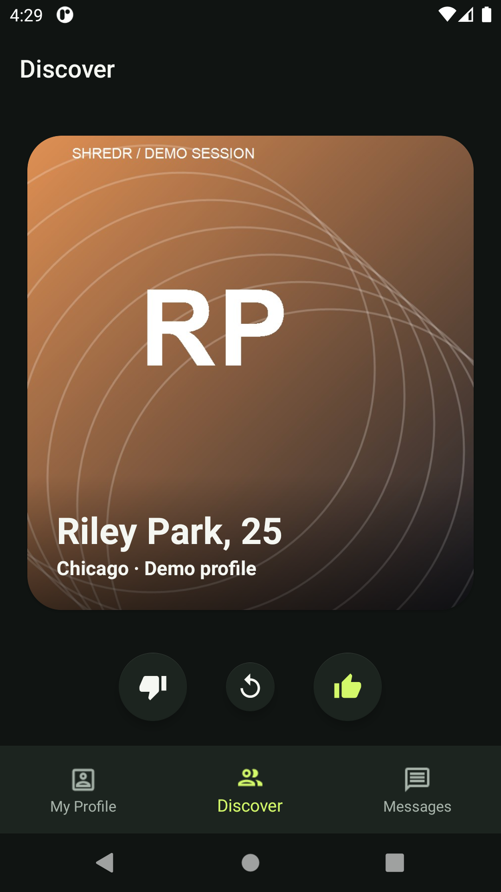
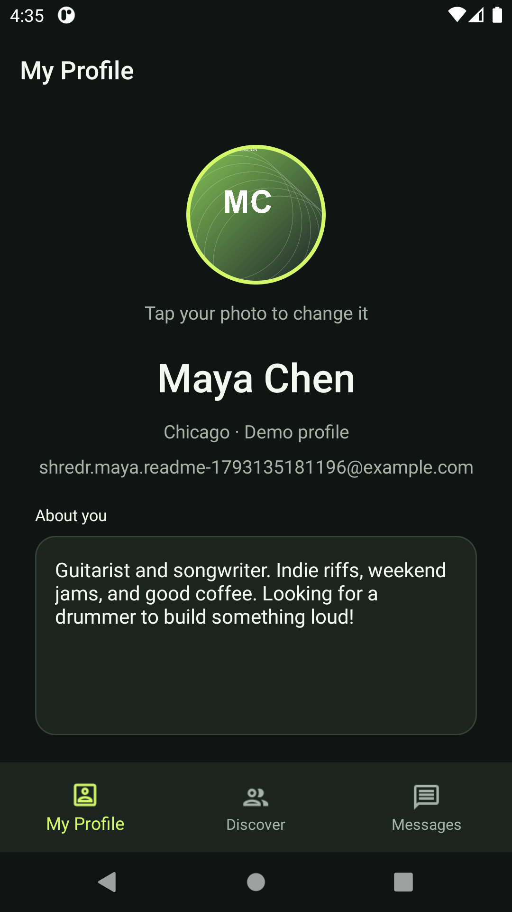
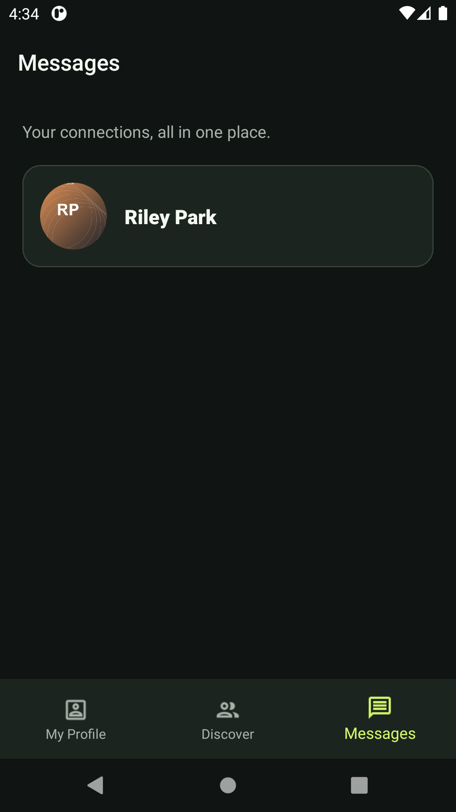
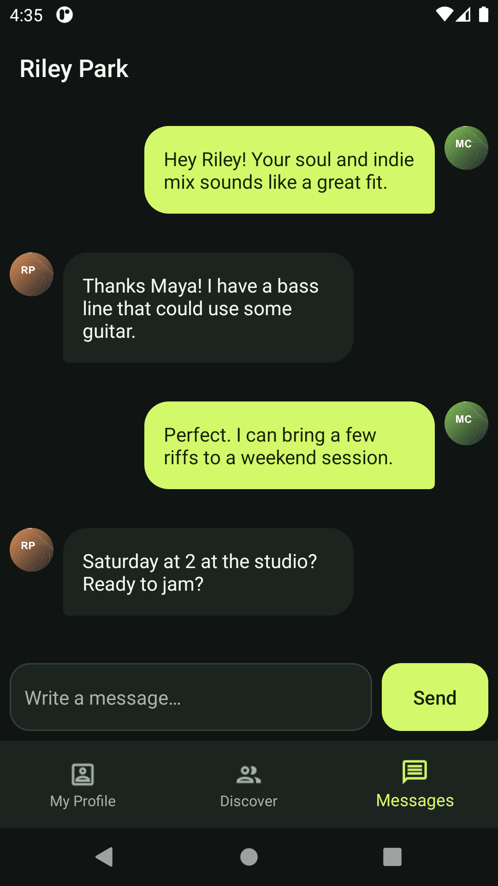
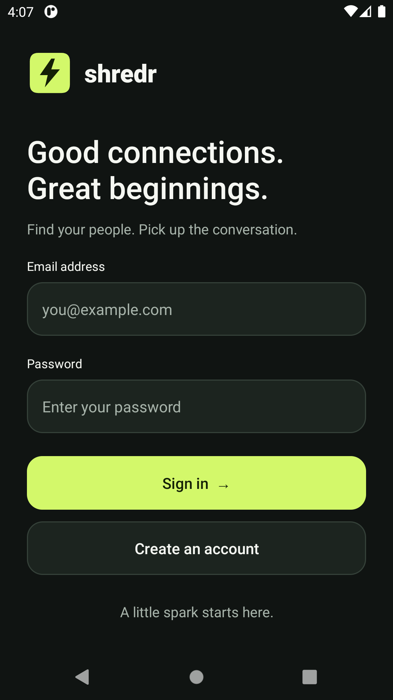
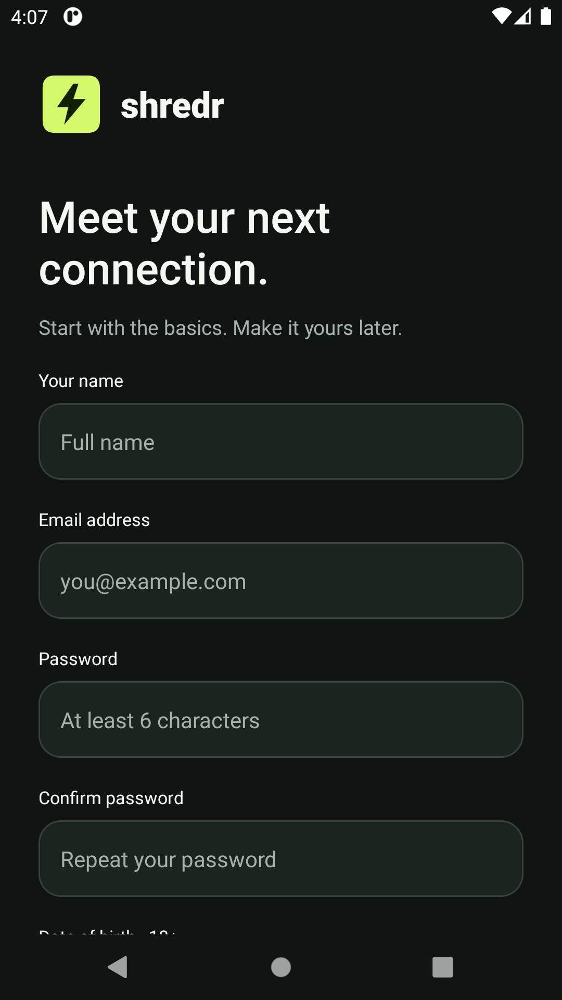
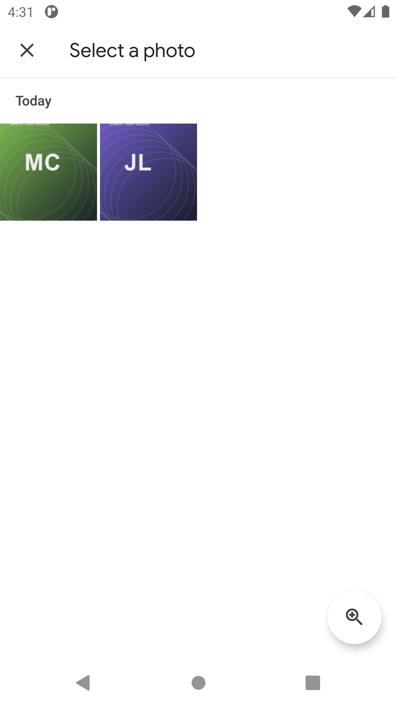
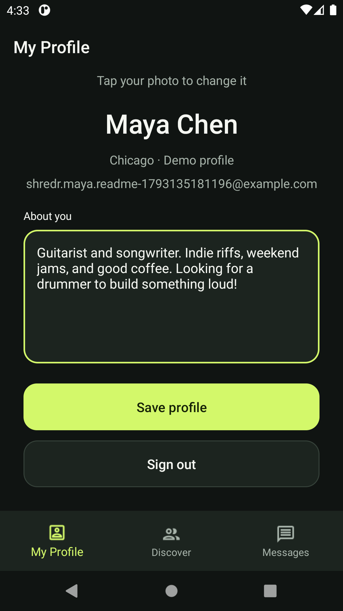

# Shredr

### An Android social-matching prototype built with Kotlin and Firebase

Shredr brings account creation, profile discovery, mutual matching, and messaging into one native Android application. Users browse profile cards, express interest with a swipe, and connect through a match-based messaging flow.

The project demonstrates integration across mobile UI, asynchronous data access, authentication, cloud storage, and event-driven updates.

## Screenshots

Captured from the running Android app on an API 30 emulator. Profiles, artwork, and conversations use fictional demo accounts; no real user content is shown.

| Discover musicians | Edit your profile | Your connections |
| --- | --- | --- |
|  |  |  |

| Conversation | Sign in | Create an account |
| --- | --- | --- |
|  |  |  |

Gallery selection and profile editing

| Choose a photo | Save a bio |
| --- | --- |
|  |  |

## Features

- **Account registration and sign-in** using Firebase Authentication, with form validation.
- **User profiles** with editable bios and gallery-selected profile photos stored in Firebase Storage.
- **Swipe-based discovery** with like, skip, and rewind controls using CardStackView.
- **Mutual matching** that checks for reciprocal likes and writes match records for both users.
- **Messaging** backed by Cloud Firestore snapshot listeners, with timestamp-ordered messages and separate incoming/outgoing layouts.
- **Fragment-based navigation** between discovery, profiles, and messages.

## Technical overview

| Layer | Implementation |
| --- | --- |
| Language and UI | Kotlin, Android SDK, XML layouts, AndroidX fragments |
| Authentication | Firebase Authentication |
| Application data | Cloud Firestore |
| Profile images | Firebase Storage and Picasso |
| Async operations | Kotlin coroutines and Firebase task callbacks |
| Lists and cards | RecyclerView, Groupie, CardStackView |

### How matching works

A right swipe records a like for the selected profile. The app then checks whether that person has already liked the current user. A reciprocal like creates a match record under each user's account.

The data model uses Firestore collections for `users`, `user-likes`, `user-matches`, and `user-messages`. Profile images are stored separately at `users/{uid}/profile.jpg`.

### Code worth exploring

- [Discovery and mutual matching](app/src/main/java/com/alexjanci/jamr/MainFragment.kt) — card interactions, coroutine-based profile loading, and reciprocal-like checks.
- [Chat](app/src/main/java/com/alexjanci/jamr/ChatLogFragment.kt) — Firestore listeners, message ordering, and listener removal when the screen stops.
- [Profiles](app/src/main/java/com/alexjanci/jamr/Profile.kt) — image uploads, biography updates, and live profile data.
- [Registration](app/src/main/java/com/alexjanci/jamr/SignUp.kt) — input checks, Firebase account creation, and initial profile records.
- [Card rendering](app/src/main/java/com/alexjanci/jamr/CardStackAdapter.kt) — profile presentation in the discovery stack.

## Getting started

Open Shredr and choose **Create an account** on the sign-in screen. Register with your email and password, then sign in, add a profile photo and bio, and start discovering other musicians.

The app already connects to its configured Firebase backend. You do not need to create a Firebase project, connect a Firebase account, or replace any configuration files to try it.

If you are running from source, clone this repository, open it in Android Studio, and build and run it on an Android device or emulator supporting API 26 or later. The debug build has been verified with JDK 11 and an API 30 emulator. The project uses Kotlin 1.3.72, Android Gradle Plugin 4.1.0, and compile/target SDK 30, so use a compatible Gradle/JDK environment.

## Suggested demo

With two test accounts, complete the profile data, browse discovery cards, like each other, and open the resulting match to exchange messages. Change a profile photo and bio to explore the storage and profile-update paths.

## Project status and next steps

Shredr is a portfolio prototype. The debug build and isolated live Firebase tests have passed for authentication, profile persistence, matching, mirrored messages, photo uploads, and downloads. See [verification notes](FIREBASE-VERIFICATION.md) for scope and remaining limitations.

Priorities for continued development:

- Migrate synthetic view access and older build dependencies.
- Improve loading, empty, and failure states, and remove unsafe null assumptions.
- Add offline recovery and retry coverage beyond the current atomic match/message writes.
- Harden and version-control backend security rules before public release. Live Firebase tests are opt-in and use disposable fixtures.

## Author

[Alex Janci](https://github.com/skrall3119)
